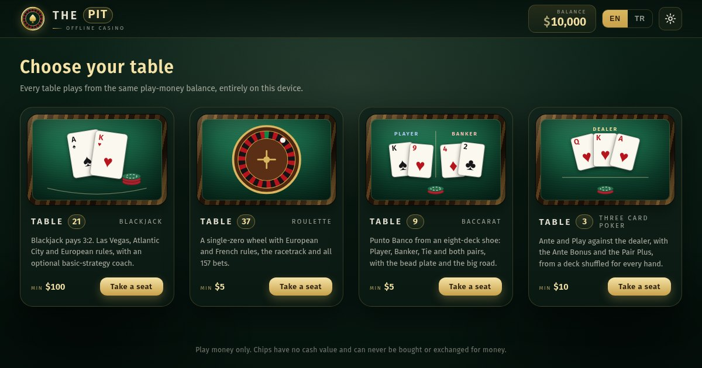

# ThePit

> [!IMPORTANT]
> **Disclaimer:** ThePit is a collection of casino table simulations made for entertainment and as a portfolio project. It uses play money only: there are no payments, deposits, withdrawals or prizes, and the chips have no cash value. It is not a gambling service, does not promote gambling and is not intended for any unlawful or harmful use. It is provided as is, without warranty, and the author accepts no liability for its use. Please read the full [disclaimer](#disclaimer).

A polished, **fully static & offline** casino of play-money table games. One lobby, one balance, every table on your own device. No build step, no runtime dependencies, no network. Open and play.

**[Enter ThePit in your browser](https://abel0x.github.io/thepit/)** · Version 1.0.1 · [GNU AGPL v3](LICENSE) · [](https://github.com/abel0x/thepit/actions/workflows/tests.yml)



## Play

- **Online:** open https://abel0x.github.io/thepit/ and pick a table. Install it from the browser menu (or *Add to Home Screen* on iOS) to keep a copy of the whole pit that works offline.
- **Locally:** clone the repository and double‑click `index.html`. Every table works straight from `file://`, completely offline:
  ```bash
  git clone https://github.com/abel0x/thepit.git
  ```
- **Local server**, for PWA install and service‑worker offline caching:
  ```bash
  cd thepit
  python3 -m http.server 8000   # or: npm run serve
  # open http://localhost:8000
  ```

## The tables

### Table 21 · Blackjack

- **Three real table profiles**: Las Vegas (6 decks, H17), Atlantic City (8 decks, S17 and late surrender) and European (6 decks, S17 and no hole card), each with its own dealing, peek, double, surrender and split rules; advanced deck and H17 edits make a custom table.
- **Full action set**: hit, stand, double down, split up to four hands (two under European rules), late surrender, insurance and even money. Blackjack pays **3:2**.
- **Truly random cards**: a multi‑deck shoe shuffled with **Fisher–Yates using `crypto.getRandomValues`**, reshuffled at 75% penetration.
- **Physical table flow**: cards leave the shoe and settle into the discard tray, every split hand owns its own wager, and winnings arrive as denomination‑correct chips.
- **Strategy coach**: optional basic‑strategy feedback or hints for the active rules, with a strategy‑accuracy statistic.
- **Side bets**: Perfect Pairs on your first two cards (25, 12 and 6 to 1) and 21+3 on those two and the dealer's up-card (100, 40, 30, 10 and 5 to 1), each up to the main bet, settled on the opening cards and paid with the round. Their house edges are counted exactly over every draw from a full shoe: 6.11% and 4.62% with six decks, 4.10% and 3.70% with eight. They are offered with six or eight decks only.
- **Card counting trainer**: the Hi-Lo running and true count shown on the shoe, or a quiz between hands that asks for the running count and keeps score. The hole card counts only once it is turned.
- **Keyboard shortcuts**: `Enter` deal · `D` deal/double · `H` hit · `S` stand · `P` split · `X` surrender · `R` rebet · `C` clear · `K` count quiz · `Y/N` insurance · `Esc` decline/close.

### Table 37 · Roulette

- **A single‑zero wheel with two rule sets**: *European*, where every bet loses on zero (house edge 2.70%), and *French*, where La Partage returns half of each even‑money bet on zero (1.35% on those bets).
- **Every bet on the table**: all 157 standard bets, placed on the cell, line or crossing they belong to, plus the French racetrack with Voisins du Zéro, Tiers du Cylindre, Orphelins, Jeu Zéro and neighbour bets.
- **Fair, unbiased results**: every number is drawn with `crypto.getRandomValues` and rejection sampling before the ball is launched; the wheel is then choreographed to land on it.
- **A wheel that behaves like one**: a locally painted mahogany wheel whose ball slows on the track, strikes a deflector, hops across the frets and rocks to rest in its pocket.
- **Results and statistics**: recent numbers, hot and cold numbers and distributions over the last 500 spins.
- **Keyboard shortcuts**: `Space`/`Enter` spin · `1`–`6` chips · `Z` or `Backspace` undo · `C` clear · `D` double · `R` rebet · `T` racetrack · `I` statistics · `M` sound · `Esc` close.

### Table 9 · Baccarat

- **Punto Banco from an eight-deck shoe**: shuffled with `crypto.getRandomValues`, a fresh shoe burns as many cards as its first card counts, and the cut card sits fourteen cards from the end.
- **The complete tableau**: naturals stop the coup, the Player draws on 0 to 5, and the Banker's third card follows its total and the Player's third card, exactly as at a real table. An exhaustive check of every coup an eight-deck shoe can deal gives the published odds: Banker 45.86%, Player 44.62%, Tie 9.52%.
- **Every bet**: Player 1:1, Banker 19:20 (*Classic*, 5% commission) or 1:1 with a six paying 1:2 (*No commission*), Tie 8:1 and both pairs 11:1. A tie returns the Player and Banker bets.
- **The Dragon Bonus on either hand**: a natural that wins pays 1:1 and a tie of naturals is returned; a win without a natural pays by its margin, from 1:1 at four points to 30:1 at nine. Counted over the whole shoe, the house keeps 2.65% of the Player dragon and 9.37% of the Banker dragon.
- **A commission box, as at a real table**: a Banker win is paid at even money and its 5% commission is kept beside it to the cent; each whole dollar in the box comes off a later payout. So every stake, even $5, pays exactly 19 to 20 and the Banker's house edge is 1.06% at any size. Without commission, the half dollar of an odd stake on a Banker six waits in the box for the player.
- **Dealt as the croupier does**: four cards face down, the Player's hand turned, then the Banker's, and any third card laid sideways; losing chips are swept away and winnings paid beside the stake.
- **The scoreboards**: the bead plate and the big road, with its dragon tails and tie marks, follow the shoe and start again with every new one.
- **Keyboard shortcuts**: `Space`/`Enter` deal · `1`–`6` chips · `P` Player · `B` Banker · `T` Tie · `Z` or `Backspace` undo · `C` clear · `D` double · `R` rebet · `M` sound.

### Table 3 · Three Card Poker

- **Ante and Play against the dealer**: one deck, shuffled with `crypto.getRandomValues` for every hand. See your three cards, then play by matching the Ante or fold.
- **The dealer qualifies with Queen high**: if not, the Ante pays 1:1 and the Play bet is returned; if so, the better hand wins both at 1:1 and a tie returns both. A straight beats a flush, and A-2-3 is the lowest straight.
- **Ante Bonus and Pair Plus**: straight flush 5:1, three of a kind 4:1 and straight 1:1 on every hand played; Pair Plus pays 40, 30, 6, 4 and 1 to 1 on the player's hand alone, or with the flush at 3 to 1 under the Low flush pay table chosen in the settings. An exhaustive check of all 407,170,400 deals gives the published house edges: 3.37% of the Ante with the best strategy, 2.32% on Pair Plus, and 7.28% under Low flush.
- **The 6-Card Bonus**: up to $100 on the best five-card hand among the player's three cards and the dealer's three, played or folded: royal flush 1000:1, straight flush 200:1, four of a kind 100:1, full house 20:1, flush 15:1, straight 10:1, three of a kind 7:1. An exhaustive count of all 20,358,520 six-card deals gives its 8.56% house edge.
- **An optional strategy hint**: play Queen-6-4 or better, fold anything less, shown on the banner and on the button it picks.
- **Saved at every step**: the hand and its stake before the first card, the decision and the Play bet before the dealer's cards. A reload brings the same cards back to the decision, or settles a decided hand.
- **Keyboard shortcuts**: `Space`/`Enter` deal or play · `1`–`6` chips · `A` Ante · `S` Pair Plus · `B` 6-Card Bonus · `P` play · `F` fold · `Z` or `Backspace` undo · `C` clear · `D` double · `R` rebet · `M` sound.

### Table 7 · Craps

- **The whole layout**: Pass and Don't pass with odds up to 3, 4 and 5 times, Come and Don't come travelling to their numbers with their own odds, Place 4 to 10, the Field (2 pays double, 12 triple), the four Hardways and the one-roll bets in the middle.
- **Put, Hop and Fire**: once a point is on, a come bet can be put straight on any number and take odds there; seventeen hop bets win on one roll of their pair of dice (15 or 30 to 1); and the Fire Bet, up to $25, counts the different points a new shooter makes before the seven out: 4 pay 24 to 1, 5 pay 249 to 1, all 6 pay 999 to 1, lit on the layout as they are made. An exact count over every shooter gives the Fire Bet its 20.76% edge.
- **Real table rules**: line bets before a point, come bets after; Place bets, Hardways and the odds behind a come bet are off on the come-out; a pass or come bet with a point plays until it is decided, other bets come down with a right-click.
- **Dice from `crypto.getRandomValues`**, the puck on the point and the last rolls beside the dice. Every bet's house edge, worked out exactly from the 36 rolls, matches the published one: Pass 1.41%, Don't pass 1.36%, odds 0%.
- **One round at a time**: while bets stand on the layout the round stays open and the other tables wait; the bets, the new money and the dice are saved before the dice are shown.
- **Keyboard shortcuts**: `Space`/`Enter` roll · `1`–`6` chips · `P` Pass line · `F` Field · `H` hop bets · `Z` or `Backspace` undo · `C` clear · `R` rebet · `M` sound.

### Table 2 · Casino Hold'em

- **Two cards against the dealer's**: one deck shuffled for every hand; see your two cards and the flop, then call with twice the Ante or fold.
- **The dealer qualifies with a pair of fours**: if not, the Ante pays by your hand and the Call is returned; if so, the best five of seven win the Ante by your hand (up to 100 to 1 for a royal flush) and the Call at 1 to 1.
- **The AA Bonus**: a pair of aces or better among your two cards and the flop pays up to 100 to 1, call or fold. Counting all 2,598,960 five-card hands confirms its 6.26% house edge.
- **Saved at every step**: all nine cards and the stake before the first card, the decision and the Call before the turn; a reload brings the same flop back to the decision, or settles a decided hand.
- **Keyboard shortcuts**: `Space`/`Enter` deal or call · `1`–`6` chips · `A` Ante · `B` AA Bonus · `L` call · `F` fold · `Z` or `Backspace` undo · `C` clear · `D` double · `R` rebet · `M` sound.

### Slot 5 · Slot machine

- **Five reels, three rows, 20 lines**: an original machine with sevens, diamonds, bells, horseshoes and card ranks, every reel stopped with `crypto.getRandomValues`.
- **Cards or fruits**: in the settings the card ranks can turn into watermelons, grapes, lemons and cherries; only the faces change, so the seven, the pays and the return stay the same.
- **Sevens on top**: five sevens on a line pay 1,000 times the line bet, the biggest prize of the machine, above five wilds at 750.
- **Wild and stars**: the wild stands in for every symbol but the star; stars pay anywhere and three or more bring ten free spins at triple pay, drawn with the paid spin.
- **A return worked out exactly**: the reel strips and pays give 95.82% over the long run, confirmed by counting all 33,554,432 stops of the reels; free spins come about once in 140 paid spins.
- **Chips for the bet**: a chip from $1 to $100 sets the bet on each of the 20 lines, and the total stands on the bet plate as the pit's chips.
- **Saved before the reels turn**: the spin, its free spins and the stake; a reload settles the very same spin.
- **Autoplay**: 10, 25, 50 or 100 spins that stop early at a loss limit or on a big win, both counted in total bets, when free spins start, when the balance cannot pay the next spin, or at a press of Stop. It is never saved, so a reload always stops it.
- **Keyboard shortcuts**: `Space`/`Enter` spin, or stop autoplay · `A` autoplay · `1`–`6` bet per line · `M` sound.

### Poker 11 · Video poker

- **Three games**: five cards from one deck shuffled with `crypto.getRandomValues` for every hand; hold any of them and draw once. In every game a natural royal flush pays 800 a coin when all five coins are bet.
- **Four pay tables**: Jacks or Better 9/6, with the full house at 9 and the flush at 6, and 8/5; Double Bonus 9/7/5, paying four aces 160 and four twos, threes or fours 80; and Deuces Wild, where every two is wild, four deuces pay 200 and three of a kind is the smallest hand. Counting the best hold of all 2,598,960 deals gives their returns exactly: 99.54%, 97.30%, 99.11% and 99.73% with five coins.
- **Coins from the pit's chips**: a chip from $1 to $500 sets the coin, *Bet one* counts one to five coins and *Bet max* bets five and deals.
- **An exact strategy hint**: the hold that returns the most on average, worked out on your device from every possible draw of every one of the 32 holds. *All holds* lists the 32 with their value per coin, best first, and holds the one you pick; a different hold is told what it gave up.
- **Strategy statistics**: how often your hold was the best one, and what the others gave up on average, in dollars.
- **Saved before the first card**: the hand, the five cards of its draw and the stake, then the hold before the new cards are turned; a reload brings the same hand back to the hold, or settles a drawn one.
- **Keyboard shortcuts**: `Space`/`Enter` deal or draw · `1`–`5` hold a card · `1`–`6` coin value between hands · `H` all holds · `B` bet one · `X` bet max · `M` sound.

### Table 18 · Sic Bo

- **Three dice, one roll, every bet**: Small and Big, Odd and Even, the fourteen totals from 4 to 17, the six triples and Any triple, the six doubles, the fifteen two-dice combinations and the six single numbers. Every bet on the layout is decided by the roll it was made for.
- **The classic pay table**: totals from 6 to 1 up to 60 to 1, a triple 180 to 1, Any triple 30 to 1, a double 10 to 1, a combination 5 to 1, and a single number 1, 2 or 3 to 1 for each die that shows it. Small, Big, Odd and Even lose to any triple.
- **Odds counted from all 216 rolls**: every one of the 52 bets is checked on every roll against the rules, and its house edge matches the published one, from 2.78% on Small and Big to 18.98% on the totals 9 and 12.
- **The dice light the layout**: after each roll every spot the dice win lights up, losing chips are swept away and winners are paid beside their stake; the last rolls beside the dice show small, big and triples.
- **Saved before the dice show**: the bets, the stake and the dice; a reload settles the very same roll.
- **Statistics**: the last 500 rolls charted by total, by single number and by Small, Big, Odd, Even and triples, each bar marked with its exact chance and the rolls since it last came.
- **Keyboard shortcuts**: `Space`/`Enter` roll · `1`–`6` chips · `S` Small · `B` Big · `I` statistics · `Z` or `Backspace` undo · `C` clear · `R` rebet · `M` sound.

### Keno 80 · Keno

- **Mark up to ten of eighty**: tap numbers on the ticket or use *Quick pick*; the machine draws twenty balls with `crypto.getRandomValues`, one by one, and lights every mark it catches.
- **A pay table for every count of marks**: from 1 to 10 marks, each with its own pays, shown in dollars for the bet beside the board. Ten marks pay even when none is caught.
- **Returns counted exactly**: every pay table is checked with whole-number counts over all 3,535,316,142,212,174,320 possible draws. Three to ten marks return between 91.91% and 92.96%; with whole-dollar pays one mark returns 75% and two marks 90.19%.
- **Chips for the bet**: a chip from $1 to $100 sets the bet on a game, and the ticket stays marked for the next one.
- **Multi-race**: play the same ticket for 1, 5, 10 or 20 draws in a row. Every draw is paid for, drawn and saved before the first ball, shown in turn with its catch and the winnings so far, and the lot is paid together.
- **Saved before the first ball**: the ticket, the bet and every ball of every draw; a reload settles the very same game and shows its last draw.
- **Keyboard shortcuts**: `Space`/`Enter` play · `1`–`6` bet · `D` draws · `Q` quick pick · `C` clear · `M` sound.

### Wheel 54 · Big Six

- **A money wheel of 54 segments**: 24 of $1, 15 of $2, 7 of $5, 4 of $10, 2 of $20, a Joker and the pit's logo, each value spread around the wheel. The segment is drawn with `crypto.getRandomValues` and the wheel turns four times and more before it slows to a stop under the pointer.
- **Seven bets**: a dollar symbol pays its number to 1, the Joker and the logo 40 to 1. Every bet is checked on all 54 segments, and its house edge matches the published one, from 11.11% on $1 to 24.07% on the Joker and the logo.
- **The wheel lights the layout**: the winning spot lights up, losing chips are swept away, winners are paid beside their stake, and the last spins line up beside the banner in the colours of the wheel.
- **Saved before the wheel turns**: the bets, the stake and the segment; a reload settles the very same spin and shows the wheel where it stopped.
- **Statistics**: the last 500 spins charted by symbol, each bar marked with its share of the wheel and the spins since it last came.
- **Keyboard shortcuts**: `Space`/`Enter` spin · `1`–`6` chips · `I` statistics · `Z` or `Backspace` undo · `C` clear · `R` rebet · `M` sound.

### Table 13 · Red Dog

- **Two cards set the spread**: an eight-deck shoe shuffled with `crypto.getRandomValues` for every hand deals two cards face up, and the spread is the number of ranks between them, the ace always high. The ladder of the thirteen ranks lights the ones between.
- **Raise or call**: raise to double the Ante, or call, and the third card is dealt. Between the first two, both bets are paid by the spread: 5 to 1 for a spread of 1, 4 to 1 for 2, 2 to 1 for 3 and even money from 4 to 11. A card of either rank is out.
- **Pushes and three of a kind**: two ranks in a row are a push without a third card; a pair always draws one, cannot be raised, and pays 11 to 1 when it makes three of a kind, a push otherwise.
- **A return worked out exactly**: counting every deal of three cards from the 416-card shoe gives a house edge of 2.75% of the Ante when raising every spread of 7 or more, the best strategy, and 7.88% when never raising. The optional strategy hint says which.
- **Saved at every step**: all three cards and the stake before the first card, the decision and the Raise before the third; a reload brings the same cards back to the decision, or settles a decided hand.
- **Keyboard shortcuts**: `Space`/`Enter` deal or call · `1`–`6` chips · `A` Ante · `R` raise or rebet · `C` call or clear · `Z` or `Backspace` undo · `D` double · `M` sound.

### Drop 16 · Peg board

- **Three boards, three risks**: drop a ball down 8, 12 or 16 rows of pegs; at every row it bounces left or right with an even chance drawn by `crypto.getRandomValues`, and lands in one of the slots at the bottom, which pays its multiple of the bet. Low risk pays back something on most drops; high risk pays little in the middle and up to 1000 times the bet at the edges of the 16-row board.
- **Returns counted exactly**: every pay table is this machine's own, and every return is counted over all the ways down a board, 256, 4,096 or 65,536 of them, and checked again path by path: from 96.88% to 97.25%.
- **Bets in tens**: a chip from $10 to $5,000 sets the bet on each ball, so every multiple with one decimal pays whole dollars.
- **Up to twenty balls**: drop 1, 5, 10 or 20 balls at a time. Every ball's way down is drawn and saved before the first one falls, each lights the pegs it meets and the slot it lands in, and they are paid together.
- **Saved before the first ball**: the board, the bet and every path; a reload settles the very same drop.
- **Keyboard shortcuts**: `Space`/`Enter` drop · `1`–`6` bet · `B` balls · `W` rows · `K` risk · `M` sound.

### Table 4 · Fan-Tan

- **Beads counted off in fours**: the croupier's pile holds 41 to 104 beads, drawn with `crypto.getRandomValues`; the bowl is lifted, the beads are taken away four at a time, and the one to four left are the number that wins. Each number is left by sixteen of the sixty-four piles.
- **Thirty-eight bets**: Fan on one number at 3 to 1; Kwok on the two numbers at a corner, Odd and Even at 1 to 1; Sheh Sam Hong on three numbers at 1 to 3; twelve Nim that win on one number at 2 to 1 and are returned on another; and twelve Nga Tan that win on two numbers at 1 to 2 and are returned on a third.
- **5% commission, paid to the cent**: every win is paid its odds less 5%. The whole dollars are paid at once and the change waits in the box beside the plaque for a later win, so every bet pays exactly its odds less 5%: a house edge of 3.75% on Fan, 2.50% on Nim, Kwok, Odd and Even, 1.25% on Nga Tan and Sheh Sam Hong, checked over every result.
- **The layout lights up**: the spots the number wins are lit and their stacks grow to what they return, the spots returned are marked, losing chips are swept away, and the last results line up above the layout in the colour of each number.
- **Saved before the bowl is lifted**: the bets, the stake and the pile; a reload settles the very same round and shows the beads counted.
- **Keyboard shortcuts**: `Space`/`Enter` open · `1`–`6` chips · `O` Odd · `E` Even · `Z` or `Backspace` undo · `C` clear · `D` double · `R` rebet · `M` sound.

## One pit

- **One balance for every table**: chips won at Table 37 can be played at Table 21. Supporting browsers guard the balance with a single Web Lock across every page and tab, so a hand at one table and a spin at another can never overwrite each other; without that API, each tab plays a separate session balance and says so.
- **One round at a time**: a hand or a spin left unfinished is saved before it is played, so a reload, a crash, a closed tab or a trip back to the lobby resumes it with the same cards or the same result. Until it is played out, its stake stays on that table: the lobby marks the table, and the other tables wait instead of spending it.
- **One set of chips**: every table bets with the same clay chips, and every value keeps one colour wherever it appears, in a tray, on the felt or in a payout: $1 white, $5 red, $10 brown, $25 green, $50 orange, $100 black, $500 purple, $1K yellow, $5K blue, $25K pink, $100K silver, and All-in bordeaux. Each table offers its own tray of them: Table 21 from $100; Table 37, Table 9, Table 7, Table 2, Table 18, Table 4 and Wheel 54 from $5; Table 3 and Table 13 from $10; Slot 5 a chip for each line from $1, Poker 11 a coin from $1, Keno 80 a bet from $1 and Drop 16 a bet from $10.
- **The lobby**: the balance, every table with its rules and limits, and the settings the whole pit shares. *Add play money* only adds free chips.
- **Your play**: every table's rounds, what it took and what it paid back, the net and the return for every dollar staked, with the pit's total, read from each table's own statistics.
- **Your save on file**: *Download a backup* writes the balance, every table's statistics and settings, the last bets and any unfinished round to one JSON file; *Restore from a file* checks it is a ThePit backup, asks first, and replaces everything under the account lock, so no table can be in the middle of a round while it does.
- **Five cloths, one language**: Emerald, Midnight, Bordeaux, Onyx and Amethyst, each with its own card back at every card table, and the English or Turkish language follow the player from the lobby to every table and back.
- **One installable app**: one manifest and one offline cache for the lobby and every table. Updates wait until no round is in play and do not force another open tab to reload.
- **Built for every screen**: from 320 px phones to large desktops, with keyboard play, contained dialog focus, available zoom and reduced motion.
- **Local sound and typography**: Ogg Vorbis samples with AAC (`.m4a`) twins for Safari, and a locally bundled OFL‑licensed WOFF2 font family.

## Privacy

ThePit has no accounts, analytics, cookies or trackers, and it talks to no server beyond loading its own files. Settings, statistics, results history, the play-money balance and any unfinished round are kept in your browser's `localStorage` and never leave your device; clearing the site's data resets them. The online version is hosted on GitHub Pages, which may log visits as described in [GitHub's privacy statement](https://docs.github.com/en/site-policy/privacy-policies/github-general-privacy-statement). The site is registered with Google Search Console, which only reports how the pages appear in Google's results: nothing on the pages runs for it, and a visit tells Google nothing.

## Verify

The core test suite uses only Node's built-in test runner (Node.js 22.12 or newer); there is nothing to install:

```bash
npm test                 # node --test "tests/**/*.test.js" "tests/**/*.test.cjs"
```

The suite currently executes **950 deterministic cases**. It covers every table's engine, rules, payouts and strategy charts (baccarat's odds against an exhaustive count of every coup an eight-deck shoe can deal, Three Card Poker's against every one of its 407,170,400 deals and its 6-Card Bonus against all 20,358,520 six-card deals, the blackjack side bets against every draw of a full shoe, the slot machine's against all 33,554,432 stops of its reels, every craps bet against the 36 rolls of two dice and the Fire Bet against every shooter, the AA Bonus against all 2,598,960 five-card hands, video poker's best play in each of its three games against every one of its 2,598,960 deals, every Sic Bo bet against the 216 rolls of three dice, every keno pay table against all 3,535,316,142,212,174,320 draws, every Big Six bet against the 54 segments of the wheel, Red Dog against every deal of three cards from its 416-card shoe, every peg board against each of its 256, 4,096 or 65,536 ways down, and every Fan-Tan bet against the four results), a pit-wide economy check that every table settles in whole dollars and accounts for every dollar staked over thousands of seeded rounds, that long runs return what the exact odds say and that whole-dollar rounding costs exactly what the rules texts say, the shared wallet and its Web Locks, the one-round-at-a-time rule, saved-state validation, translation parity on every page, the service worker and its safe updates, the complete offline shell of the lobby and every table, and the one address each page and the sitemap give search engines. GitHub Actions runs it on Node 22, 24 and 26 for every push and pull request, and publishes a push to `main` on GitHub Pages only after it has passed on all three.

The optional real-browser suite adds **429 Chromium tests**: `file://` play, the shared balance between the lobby and every table, rounds resumed after reloads and closed tabs, offline PWA reloads, multiple tabs, keyboard use, both languages, screen sizes from 320 px to 1920 px, and every control within reach at twelve screen sizes on every table but Table 21, whose page scrolls instead. Puppeteer is declared as a development-only dependency in `package.json`; the pit itself never loads it:

```bash
npm install              # also downloads the Chrome build Puppeteer drives
npm run test:browser
```

## Development

There is no build step: edit a file and reload the page. Whenever a change touches a file the pit ships, bump `CACHE_VERSION` in `sw.js` so that installed copies pick up the new version; the update waits until no round is in play. `tools/generate-card-audio.sh` rebuilds the card-table samples in `shared/audio/` and `tools/generate-roulette-audio.sh` the roulette ones, with ffmpeg; `tools/generate-icons.sh` rebuilds the install icons from `icon.svg` with rsvg-convert and ImageMagick, `node tools/sync-brand-marks.cjs` redraws each table's header mark from its `icon.svg`, and `node tools/generate-social-preview.cjs` draws `assets/social-preview.jpg` from the lobby with Puppeteer and ImageMagick, so run it after adding a table.

A new table lives in its own folder under `games/`. It loads `shared/css/pit.css` and `shared/css/table.css` before its own stylesheet, `shared/js/pit.js` and `shared/js/i18n.js` first and `shared/js/pwa.js` last, adds its own words with `I18n.define()` (a word the pit already has can never be redefined), keeps its own data under `pit.<table>.*`, and joins `Pit.TABLES`, the lobby and the cache list in `sw.js`.

## Files

```
index.html                 the lobby
lobby/                     lobby look, its own words (EN/TR) and behaviour
shared/js/pit.js           what every page shares: the wallet, its lock, the cloth
shared/js/i18n.js          the language engine and the words every page shares (EN/TR)
shared/css/pit.css         the look every page shares: font, cloths, top bar, dialogs
shared/css/table.css       the look every table shares: sound, mixer, rule profiles, chips, buttons
shared/css/cards.css       the look of a playing card, with a back for every cloth
shared/js/cards.js         the card maker every card table draws its cards with
shared/js/card-sound.js    card, chip and shuffle sounds with Web Audio cues for card tables
shared/js/chips.js         the pit's one chip palette and the clay chip drawn at every table
shared/css/chip-tables.css the look the chip tables share: frame, dialogs, tray, stacks, bet tools
shared/audio/              the card-table samples (Ogg + AAC)
shared/js/pwa.js           optional service-worker registration and safe updates
shared/fonts/              local WOFF2 interface font + OFL license
games/blackjack/           Table 21: page, look, engine, rules, strategy coach
games/roulette/            Table 37: page, look, engine, layout, wheel, sounds
games/baccarat/            Table 9: page, look, engine, saved state
games/threecard/           Table 3: page, look, engine, saved state
games/slot/                Slot 5: page, look, engine, saved state
games/craps/               Table 7: page, look, engine, saved state
games/holdem/              Table 2: page, look, engine, saved state
games/videopoker/          Poker 11: page, look, engine, saved state
games/sicbo/               Table 18: page, look, engine, saved state
games/keno/                Keno 80: page, look, engine, saved state
games/bigsix/              Wheel 54: page, look, engine, saved state
games/reddog/              Table 13: page, look, engine, saved state
games/pegboard/            Drop 16: page, look, engine, saved state
games/fantan/              Table 4: page, look, engine, saved state
manifest.json              installable PWA metadata
sitemap.xml                the lobby and every table, for search engines
sw.js                      offline cache for the whole pit (only used over http)
icon.svg                   app icon (apple-touch-icon.png: iOS home-screen PNG)
assets/icons/              PNG install icons (192, 512 and a maskable 512)
assets/social-preview.jpg  1200×630 link-preview image
tools/                     reproducible local audio, icon, header-mark and preview generators
tests/                     dependency-free tests for every table, the lobby and the site
tests/browser/             optional real-browser suites (Puppeteer, development only)
.github/workflows/         continuous integration for the core suite and the Pages publish
package.json               test scripts + dev-only Puppeteer (not needed to play)
CHANGELOG.md               release notes
LICENSE                    GNU Affero General Public License v3
```

## Disclaimer

ThePit is a free collection of casino table simulations built for entertainment, for practising basic strategy and as a portfolio project.

- **Play money only.** Chips and balances have no cash value. They cannot be bought, sold or exchanged for money or prizes, and *Add play money* only adds free chips.
- **Not gambling.** ThePit is not a gambling service, offers no real-money play, does not promote gambling and is not intended for any unlawful or harmful use.
- **No real-money advice.** The strategy coach teaches textbook basic strategy for learning purposes, and every spin and every hand is independent. Neither the coach, the statistics nor any result is a guide to real-money play.
- **Intended for adults.** Like other simulated casino games, ThePit is not aimed at minors.
- **No affiliation.** ThePit is not affiliated with any casino. The Las Vegas, Atlantic City, European and French rules only describe common rule sets.
- **No warranty, no liability.** The software is provided as is, without warranty of any kind, and the author accepts no liability for its use; see sections 15 and 16 of the [license](LICENSE). You are responsible for complying with the laws that apply where you live.

If gambling is causing problems for you or someone close to you, please seek help.

## License

Copyright (C) 2026 abel0x

ThePit is free software: you can redistribute it and/or modify it under the terms of the [GNU Affero General Public License](LICENSE) as published by the Free Software Foundation, either version 3 of the License, or (at your option) any later version. It is distributed in the hope that it will be useful, but WITHOUT ANY WARRANTY; without even the implied warranty of MERCHANTABILITY or FITNESS FOR A PARTICULAR PURPOSE.

The bundled interface font is licensed separately under the SIL Open Font License 1.1 ([`shared/fonts/OFL.txt`](shared/fonts/OFL.txt)).
